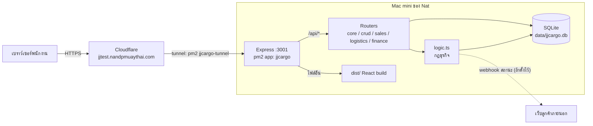
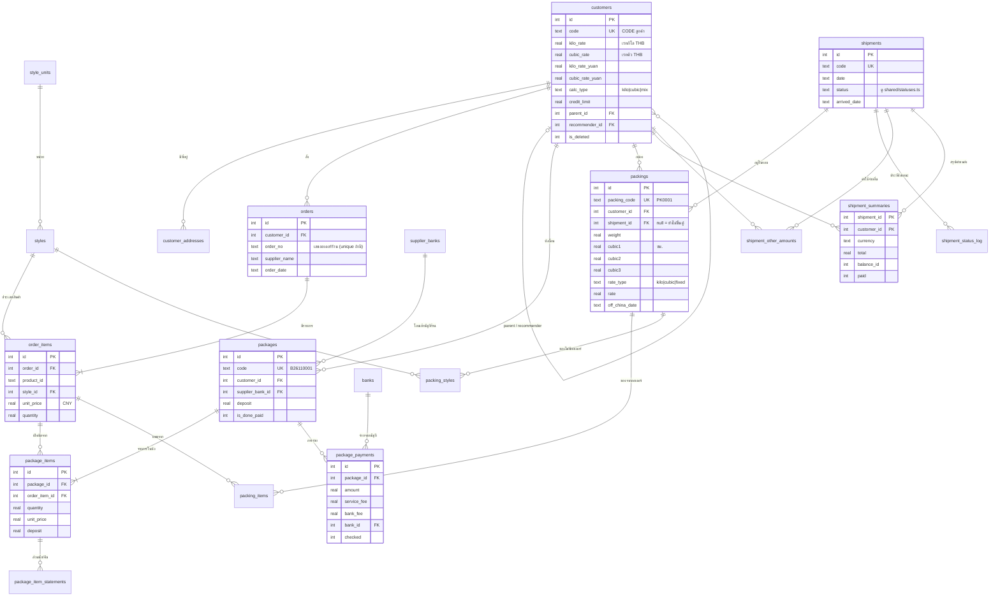
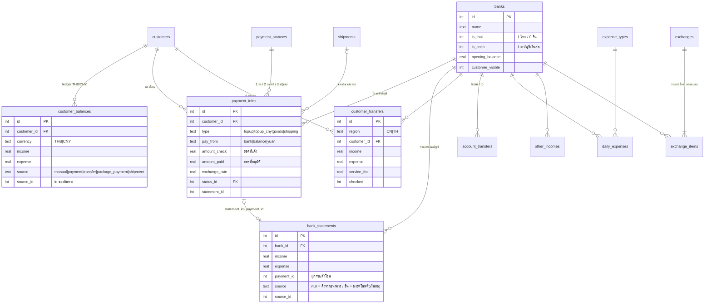
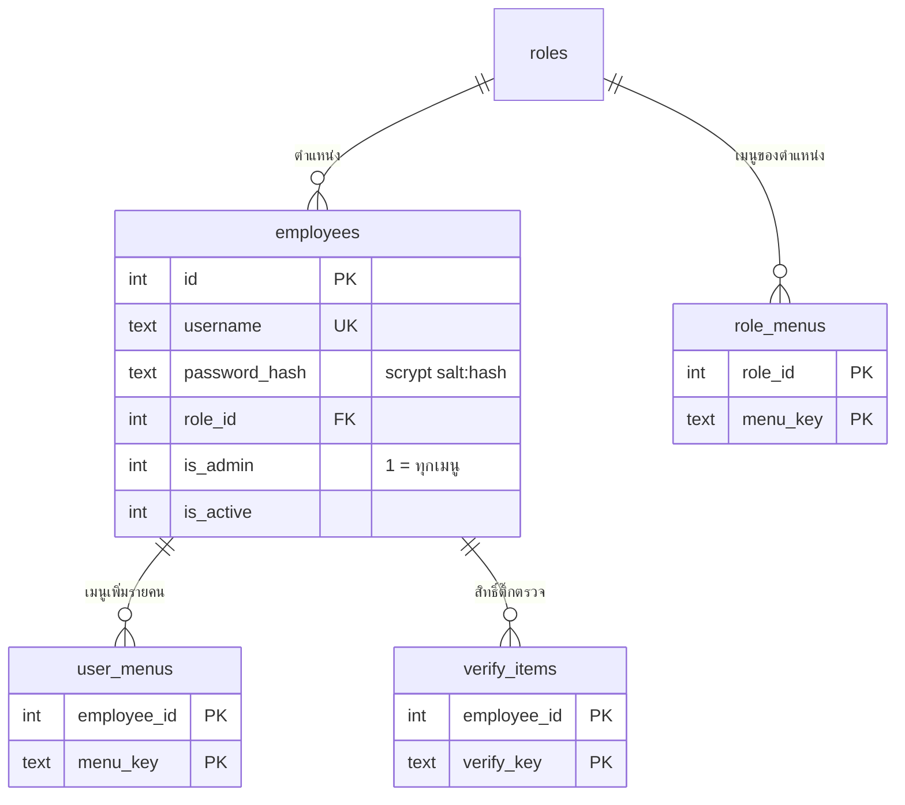
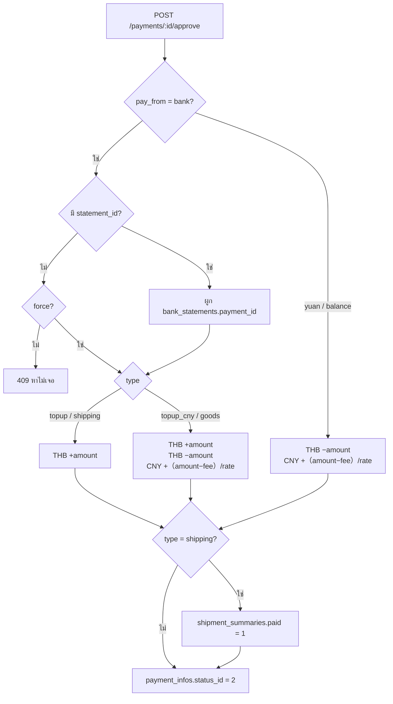

# JJ Cargo — เอกสารเทคนิค

> สำหรับ Nat / developer ที่จะดูแลต่อ · อัปเดต 3 พ.ย. 2026
> อ่านคู่กับ `CLAUDE.md` (กฎเรื่องเงิน) และ `docs/คู่มือการใช้งาน.md` (มุมมองผู้ใช้)
> ER diagram และ flow ใช้ Mermaid — เปิดใน GitHub / VS Code (Markdown Preview Mermaid) / Obsidian จะเห็นเป็นรูป

---

## 1. สรุปใน 1 นาที

- **เว็บ back-office ตัวเดียว** (ไม่มีฝั่งลูกค้า) เขียนใหม่จากโปรแกรม WinForms `JJCargoForm.exe`
- **Backend:** Node 22 + Express 4 + TypeScript (รันด้วย `tsx` ไม่ต้อง build)
- **Database:** SQLite ไฟล์เดียว (`data/jjcargo.db`) ผ่าน `node:sqlite` ที่มากับ Node — ไม่มี ORM, query เป็น SQL ตรงๆ, เป็น synchronous ทั้งหมด
- **Frontend:** React 18 + Vite 5 + react-router 6, CSS ธรรมดา, `jsbarcode` ทำบาร์โค้ด
- **Auth:** cookie session เซ็นด้วย HMAC, รหัสผ่าน hash ด้วย scrypt, สิทธิ์ตาม "menu key"
- **Deploy:** Mac mini ของ Nat → `pm2` (app `jjcargo` port 3001) → Cloudflare Tunnel → https://jjtest.nandpmuaythai.com

---

## 2. Architecture



**ลำดับการทำงานของ request หนึ่งครั้ง** (`server/index.ts`)

1. `express.json()` (รับ body ได้ถึง 5 MB)
2. `publicRouter` — `/api/login`, `/api/logout` (ไม่ต้อง login)
3. `requireAuth` — อ่าน cookie `jj_session` → โหลด user + menus + verify ของ user
4. router ต่างๆ — แต่ละ route มี `needMenu('key', ...)` กันสิทธิ์
5. handler โยน `HttpError(status, msg)` → error handler แปลงเป็น `{ error: "..." }`
6. path ที่ไม่ใช่ `/api` → ส่ง `dist/index.html` (SPA)

### โครงสร้างโฟลเดอร์

```
jjcargo-web/
├─ shared/
│  ├─ menus.ts         ★ ต้นทางของเมนู + สิทธิ์ (ใช้ทั้ง server และ client), VERIFY_KEYS
│  └─ statuses.ts      สถานะรอบขนส่ง 7 ขั้น
├─ server/
│  ├─ index.ts         สร้าง express app, ต่อ router, error handler, serve dist/
│  ├─ db.ts            ★ schema ทั้งหมด + migrate() + seed + helper all/get/run/tx/audit/setting
│  ├─ auth.ts          hash รหัส, session cookie, HttpError, needMenu, canVerify
│  ├─ logic.ts         ★ กฎธุรกิจ: balance, ค่าขนส่ง, ยอดบิล, ลงเงินสด, gen รหัส, webhook
│  ├─ crud.ts          CRUD กลาง /api/r/:resource สำหรับตารางง่ายๆ
│  └─ routes/
│     ├─ core.ts       login, me, lookups, dashboard, settings, พนักงาน, สิทธิ์, audit
│     ├─ sales.ts      ลูกค้า, balance, ออเดอร์, บิล (packages), จ่ายบิล, lookup
│     ├─ logistics.ts  แพค, ชั่งทีหลัง, import ไฟล์, ขึ้นตู้, สถานะรอบ, สรุปค่าขนส่ง
│     └─ finance.ts    แจ้งโอน + ตรวจ, ฝากถอน, ธนาคาร, แลกเงิน, ค้างจ่าย
├─ src/
│  ├─ App.tsx          routes ของหน้าเว็บ + หน้า login
│  ├─ nav.tsx          layout: เมนูข้าง (พับได้), แถบบน, ค้นหาเมนู Ctrl+K, หน้าที่เปิดล่าสุด, ไอคอนของแต่ละเมนู
│  ├─ lib.tsx          api(), useApi(), i18n useT(), context (user, lookups), format ตัวเลข
│  ├─ ui.tsx           component กลาง: Page, Card, Table, Modal, Tabs, Combo, PrintModal, Barcode, Bi (ป้าย 2 ภาษา), useAsk (กล่องยืนยัน)
│  └─ pages/*.tsx      1 ไฟล์ต่อหมวด (Orders, Packages, Packing, Shipments, Customers, Payments, Bank, Accounting, Admin, Crud)
├─ scripts/
│  ├─ flow.ts          ★ จำลอง business flow ทั้งหมดผ่าน API + assert (เป็นทั้ง test และ seed)
│  ├─ e2e.ts           npm test (รัน flow บน DB ชั่วคราว)
│  └─ seed-demo.ts     npm run seed (ใส่ข้อมูลตัวอย่างลง DB ว่าง)
└─ data/jjcargo.db     ไฟล์ข้อมูลจริง (ไม่อยู่ใน git) — backup = copy ไฟล์นี้
```

★ = ไฟล์ที่ควรอ่านก่อน

---

## 3. Database

ทั้งหมด 39 ตาราง สร้างด้วย `CREATE TABLE IF NOT EXISTS` ใน `server/db.ts` ทุกครั้งที่ server start (ตารางใหม่สร้างเอง, คอลัมน์ใหม่เพิ่มผ่าน `addColumn()` ใน `migrate()`)

### 3.1 ER diagram — งานหลัก (ออเดอร์ → บิล → แพค → ขนส่ง)



### 3.2 ER diagram — เงิน (ลูกค้า, ธนาคาร, บัญชี)



### 3.3 ER diagram — ผู้ใช้และสิทธิ์



สิทธิ์ของ user = `role_menus` ของตำแหน่ง **รวมกับ** `user_menus` ของคนนั้น (admin ผ่านทุกอย่าง)

### 3.4 ตารางทั้งหมด (สรุปหน้าที่)

| กลุ่ม | ตาราง | ชื่อเดิมในโปรแกรม .NET | หน้าที่ |
|---|---|---|---|
| ผู้ใช้ | `employees`, `roles` | Employee, EmployeeRole | พนักงาน + ตำแหน่ง |
| | `role_menus`, `user_menus` | RoleMenuView, MenuView | สิทธิ์เข้าเมนู |
| | `verify_items` | VerifyItem | สิทธิ์ติ๊ก "ตรวจแล้ว" |
| | `audit_log` | — | log ทุกการกระทำสำคัญ (ใคร ทำอะไร กับอะไร) |
| | `settings` | GeneralSetting | key/value: เรทกลาง, ข้อความพิมพ์, webhook |
| ลูกค้า | `customers`, `customer_addresses`, `provinces` | Customer… | ข้อมูลลูกค้า, ที่อยู่, 77 จังหวัด |
| | `customer_balances` | CustomerBalance / CustomerYuanBalance | **ledger เงินลูกค้า** (THB/CNY ในตารางเดียว) |
| ออเดอร์ | `orders`, `order_items` | Order, OrderDtl | ของที่ลูกค้าสั่ง (ราคาหยวน) |
| | `styles`, `style_units` | Style, StyleUnit | ประเภทสินค้า + หน่วย |
| บิล | `packages`, `package_items` | Package, PackageDtl | บิลจ่ายร้านจีน |
| | `package_item_statements` | PackageDtlsStatement | ส่วนหัก/คืนเงินในบิล |
| | `package_payments` | PackagePayment | การจ่ายบิล |
| | `supplier_banks` | SupplierBank | บัญชีร้านจีน |
| ขนส่ง | `packings` | ShipmentDtl | 1 แถว = 1 กล่อง/กระสอบ |
| | `packing_items` | ShipmentDtlsItem | ของในกล่องที่มาจากออเดอร์ |
| | `packing_styles` | ShipmentDtlsStyle | ของในกล่องแบบระบุแค่ประเภท |
| | `shipments`, `shipment_status_log` | Shipment | รอบขนส่ง (ตู้) + ประวัติสถานะ |
| | `shipment_other_amounts` | ShipmentOtherAmount | ค่าใช้จ่ายอื่นต่อลูกค้าต่อรอบ |
| | `shipment_summaries` | — | ค่าขนส่งที่ "สรุปยอด" แล้ว (PK = รอบ+ลูกค้า) |
| เงิน | `payment_infos`, `payment_statuses` | PaymentInfo | แจ้งโอนของลูกค้า |
| | `customer_transfers` | China/ThailandTransferWithdraw | ฝาก/ถอนกับบริษัท |
| | `banks`, `bank_statements` | BankInfo, BankStatement | บัญชีบริษัท + รายการเดินบัญชี |
| | `account_transfers` | AccountTransfer | โอนระหว่างบัญชีบริษัท |
| | `daily_expenses`, `expense_types` | DailyExpense(+Type) | ค่าใช้จ่าย ไทย/จีน |
| | `other_incomes` | OtherIncome | รายรับอื่น |
| | `exchange_rates` | ExchangeRate | เรทรายวัน |
| | `exchanges`, `exchange_items` | HistoryExchange(+Item) | รอบแลกเงิน |

### 3.5 ค่าที่คำนวณ (ไม่ได้เก็บในตาราง)

| ค่า | คำนวณยังไง | อยู่ที่ |
|---|---|---|
| Balance ลูกค้า | `SUM(income - expense)` จาก `customer_balances` ตาม currency | `logic.customerBalance` |
| ยอดบัญชีธนาคาร | `opening_balance + SUM(income - expense)` จาก `bank_statements` | `logic.bankBalance` |
| ความคืบหน้าออเดอร์ | received = `SUM(package_items.quantity)`, packed = `SUM(packing_items.quantity)` | `logic.orderItemProgress` |
| ยอดบิล | total − deposit − deductions = due; due − paid = remaining | `logic.packageTotals` |
| ค่าขนส่งกล่อง | ดูข้อ 5.3 | `logic.packingPrice` |

---

## 4. API

ทุก endpoint อยู่ใต้ `/api`, ส่ง/รับ JSON, ต้องมี cookie session (ยกเว้น login/logout)
Error: HTTP status + `{ "error": "ข้อความ" }` — 400 ข้อมูลผิด, 401 ยังไม่ login, 403 ไม่มีสิทธิ์, 404 ไม่เจอ, 409 ขัดกับกฎธุรกิจ

คอลัมน์ "สิทธิ์" = menu key ที่ต้องมีอย่างน้อย 1 อัน (ดู `shared/menus.ts`)

### 4.1 Core (`server/routes/core.ts`)

| Method | Path | สิทธิ์ | ทำอะไร |
|---|---|---|---|
| POST | `/login` | – | `{username,password}` → set cookie |
| POST | `/logout` | – | ลบ cookie |
| GET | `/me` | login | ข้อมูล user + menus + verify |
| POST | `/me/password` | login | เปลี่ยนรหัสตัวเอง |
| GET | `/lookups` | login | ข้อมูลอ้างอิงทั้งหมดที่หน้าเว็บใช้ (ลูกค้า, ธนาคาร, styles, จังหวัด, settings, เรทล่าสุด ฯลฯ) — โหลดครั้งเดียวตอนเปิดเว็บ |
| GET | `/dashboard` | login | ตัวเลขหน้าแดชบอร์ด |
| GET/PUT | `/settings` | settings | อ่าน/แก้ settings |
| GET/POST | `/employees` | employees | รายชื่อ / เพิ่มพนักงาน |
| PUT/DELETE | `/employees/:id` | employees | แก้ / ลบ |
| DELETE | `/roles/:id` | employees | ลบตำแหน่ง |
| GET/PUT | `/permissions/:kind/:id` | permission | `kind` = `role` หรือ `user` |
| GET/PUT | `/verify/:employeeId` | verify | สิทธิ์ติ๊กตรวจ |
| GET | `/audit` | employees | log การทำงาน |

### 4.2 CRUD กลาง (`server/crud.ts`)

ตารางที่ไม่มี logic พิเศษใช้ endpoint ชุดเดียวกัน:

| Method | Path | ทำอะไร |
|---|---|---|
| GET | `/r/:name` | list (รองรับ filter ผ่าน query) |
| POST | `/r/:name` | เพิ่ม |
| PUT | `/r/:name/:id` | แก้ |
| DELETE | `/r/:name/:id` | ลบ (soft delete ถ้าตารางมี `is_deleted`) |
| POST | `/r/:name/check` | ติ๊ก/ยกเลิก "ตรวจแล้ว" (ตารางที่มี `checked`) |

`:name` ที่ใช้ได้: `customer_addresses`, `banks`, `style_units`, `styles`, `supplier_banks`, `shipments`, `expense_types`, `daily_expenses`, `other_incomes`, `account_transfers`, `exchange_rates`, `shipment_other_amounts`, `roles`, `bank_statements`
(ตารางที่เกี่ยวกับเงินสด เช่น expenses / account_transfers จะเรียก `postCash` ให้อัตโนมัติ)

### 4.3 Sales (`server/routes/sales.ts`)

| Method | Path | สิทธิ์ | ทำอะไร |
|---|---|---|---|
| GET | `/customers?q=&by=` | customer.* | ค้นลูกค้า + balance THB/CNY + ค่าขนส่งค้าง |
| GET | `/customers/:id` | login | รายละเอียด + ที่อยู่ + ยอดเงิน |
| POST/PUT/DELETE | `/customers[/:id]` | customer.info | เพิ่ม / แก้ / ลบ (soft) |
| GET | `/balances/:currency?customer_id=` | customer.balance / customer.yuan | ledger + ยอดสะสม (`THB` / `CNY`) |
| POST/PUT/DELETE | `/balances/:currency[/:id]` | 〃 | รายการ manual เท่านั้น |
| GET | `/orders` | order.* | ค้นออเดอร์ (`search=` ค้นเลขออเดอร์ / ร้าน / รหัสสินค้า / เลขบิล ทุกช่วงวันที่) |
| GET | `/orders/:id` | login | ออเดอร์ + รายการ + progress |
| POST/PUT | `/orders[/:id]` | order.new | สร้าง/แก้ (`items[]` ในตัว) |
| DELETE | `/orders/:id` | order.search | ลบได้ถ้ายังไม่เปิดบิล/แพค |
| GET | `/packages/waiting?customer_id=` | package.new | รายการออเดอร์ที่ยังเปิดบิลไม่ครบ |
| GET | `/packages` | package.* | ค้นบิล + ยอด (`search=` ค้นเลขบิล / เลขออเดอร์ / ร้าน / รหัสสินค้า) |
| GET | `/packages/next-code` | login | เลขบิลถัดไป |
| GET | `/packages/:idOrCode` | login | บิล + รายการ + ส่วนหัก + การจ่าย |
| POST/PUT/DELETE | `/packages[/:id]` | package.* | สร้าง / แก้ / ลบบิล |
| POST | `/package-items/:id/statements` | invoice.payment | เพิ่มส่วนหัก/คืน |
| DELETE | `/package-statements/:id` | 〃 | ลบส่วนหัก |
| POST | `/packages/:id/payments` | invoice.payment | **จ่ายบิล** (หัก Balance CNY) |
| GET | `/invoice-payments` | invoice.* | ค้นรายการจ่ายบิล |
| POST | `/invoice-payments/check` | invoice.paymentSearch | ติ๊กตรวจ |
| DELETE | `/invoice-payments/:id` | 〃 | ยกเลิกการจ่าย (คืนเงินเข้า Balance CNY, บิลกลับเป็นยังจ่ายไม่ครบ) |
| GET | `/lookup?q=` | package.lookup | ค้นรวม ออเดอร์/บิล/สินค้า (หน้าเว็บไม่ใช้แล้ว: ใช้ `search=` ในหน้าออเดอร์ + บิลโอน) |

### 4.4 Logistics (`server/routes/logistics.ts`)

| Method | Path | สิทธิ์ | ทำอะไร |
|---|---|---|---|
| GET | `/packing/waiting?customer_id=` | packing.new | รายการที่ยังแพคได้ |
| GET | `/packing/recent` | packing.new/nobill | กล่องที่เพิ่งแพค |
| GET | `/packing` | packing.search/offchina/weigh | ค้นกล่อง |
| GET | `/packing/by-customer` | packing.search | สรุปกล่องรายลูกค้า |
| GET | `/packing/:id` | login | รายละเอียดกล่อง |
| POST | `/packing` | packing.new/nobill | สร้างกล่อง (`boxes` ได้ถึง 200, `items[]`, `styles[]`) |
| POST | `/packing/measure` | packing.weigh | บันทึกน้ำหนัก/ขนาดหลายกล่อง `{rows:[{id,weight,cubic1..3}]}` |
| PUT/DELETE | `/packing/:id` | packing.search | แก้ / ลบกล่อง |
| POST | `/packing/:id/styles` | packing.* | เพิ่มของ (แบบประเภท) |
| PUT/DELETE | `/packing-styles/:id`, `/packing-items/:id` | packing.search | แก้/ลบของในกล่อง |
| POST | `/packing/import` | packing.bulk | `{text, commit}` — commit=false = preview |
| GET | `/shipments/:id/packings` | shipment.* | กล่องในรอบ |
| POST | `/shipments/:id/load` | packing.offchina | `{code}` สแกนกล่องขึ้นตู้ |
| POST | `/shipments/:id/unload` | packing.offchina | `{packing_id}` เอาออก |
| GET/POST | `/shipments/:id/status` | shipment.list | ประวัติ / เปลี่ยนสถานะ `{status,date,note}` |
| POST | `/shipments/:id/arrived` | shipment.list | ตั้งวันถึง |
| GET | `/shipments/:id/report` | shipment.list | รายงาน packing list |
| GET | `/shipments/:id/summary?currency=` | shipment.summary | ค่าขนส่งทุกลูกค้าในรอบ |
| GET | `/shipments/:id/summary/:customerId` | shipment.* | บิลค่าขนส่ง 1 ลูกค้า |
| POST | `/shipments/:id/summary/:customerId` | shipment.summary | **สรุปยอด** → หัก Balance + ล็อกเรท |
| DELETE | `/shipments/:id/summary/:customerId` | shipment.summary | ยกเลิกสรุปยอด (ถ้ายังไม่จ่าย) |
| POST | `/shipments/:id/summary/:customerId/paid` | shipment.summary | ติ๊กจ่ายแล้ว/ยัง |
| GET | `/shipping-charges` | shipment.search/unpaid | ค้นค่าขนส่งข้ามรอบ |

### 4.5 Finance (`server/routes/finance.ts`)

| Method | Path | สิทธิ์ | ทำอะไร |
|---|---|---|---|
| GET/POST | `/payments` | customer.payment | ค้น / เพิ่มแจ้งโอน |
| PUT/DELETE | `/payments/:id` | 〃 | แก้ / ลบ (ที่ยังไม่อนุมัติ) |
| GET | `/payments/check` | payment.check | แจ้งโอนที่รอ + บรรทัดธนาคารที่น่าจะตรง |
| POST | `/payments/:id/approve` | payment.check + verify `payment` | **อนุมัติ** → ลง Balance |
| POST | `/payments/:id/reject` | 〃 | ปฏิเสธ (ถอนเงินออกถ้าเคยอนุมัติ) |
| POST | `/payments/:id/reset` | 〃 | กลับเป็นรอตรวจ |
| GET/POST | `/transfers/:region` | transfer.china / transfer.thai | `CN` / `TH` ฝาก-ถอน |
| PUT/DELETE | `/transfers/:region/:id` | 〃 | |
| POST | `/transfers/:region/check` | 〃 | ติ๊กตรวจ |
| GET | `/bank/statements?bank_id=&from=&to=` | bank.statement | รายการเดินบัญชี + ยอดสะสม |
| GET | `/bank/unmatched` | bank.statement / payment.check | เงินเข้าที่ยังไม่ผูกกับแจ้งโอน |
| POST | `/bank/import` | bank.import | `{bank_id, rows[]}` → `{added, skipped}` |
| GET | `/bank/total` | bank.total | ยอดทุกบัญชี |
| GET/POST | `/exchanges` | exchange | รอบแลกเงิน |
| GET/DELETE | `/exchanges/:id` | exchange | |
| POST | `/exchanges/:id/items` | exchange | เพิ่มรายการโอนในรอบ |
| DELETE | `/exchange-items/:id` | exchange | |
| POST | `/exchanges/check` | exchange | ติ๊กตรวจ |
| GET | `/unpaid` | unpaid | สรุปค้างจ่ายรายลูกค้า |

---

## 5. Business flow ที่สำคัญ (เงินไหลยังไง)

### 5.1 Ledger ของลูกค้า

`customer_balances` คือสมุดบัญชีของลูกค้า ทุกบรรทัดมี `source` + `source_id` บอกว่ามาจากไหน:

| source | สร้างโดย | currency | ทิศทาง |
|---|---|---|---|
| `manual` | หน้า Balance (พนักงานเพิ่มเอง) | THB/CNY | ได้ทั้งสอง |
| `payment` | อนุมัติแจ้งโอน | THB (+CNY ถ้าแลก) | เข้า |
| `transfer` | ฝาก-ถอน CN/TH | CNY / THB | เข้า/ออก |
| `package_payment` | จ่ายบิลร้านจีน | CNY | ออก (ยอด + ค่าบริการ) |
| `shipment` | สรุปยอดค่าขนส่ง | THB หรือ CNY | ออก (`source_id = shipment_id*100000 + customer_id`) |

ยกเลิกต้นทาง → `removeBalanceBySource(source, id)` ลบบรรทัดที่เกี่ยวข้องออก
**แก้บรรทัดที่ไม่ใช่ `manual` ตรงๆ ไม่ได้** (กันยอดไม่ตรงกับต้นทาง)

### 5.2 อนุมัติแจ้งโอน



### 5.3 คำนวณค่าขนส่ง (`logic.packingPrice`)

```
cbm = cubic1 × cubic2 × cubic3 / 1,000,000          (ซม. → ลบ.ม.)
ถ้ากล่องมี rate_type:  kilo → weight × rate | cubic → cbm × rate | fixed → rate
ไม่งั้นใช้ calc_type ของลูกค้า:
   kilo  → weight × kilo_rate
   cubic → cbm × cubic_rate
   mix   → อันที่แพงกว่า
เรทของลูกค้าว่าง → ใช้ settings (kilo_rate=35, cubic_rate=5500, kilo_rate_yuan=7, cubic_rate_yuan=1100)
รวมต่อลูกค้าต่อรอบ = Σ ราคากล่อง + Σ shipment_other_amounts
```

ตอน **สรุปยอด** ระบบเขียน `rate_type/rate` ที่ใช้คำนวณลงทุกกล่อง (freeze) เพื่อไม่ให้เปลี่ยนเรทลูกค้าทีหลังแล้วบิลเก่าเปลี่ยนตาม และห้ามแก้ น้ำหนัก/ขนาด/รอบ จนกว่าจะ DELETE summary

### 5.4 บัญชีเงินสด (`logic.postCash`)

- บัญชีธนาคารจริง: รายการมาจาก **ดึงยอดธนาคาร** เท่านั้น (`source IS NULL`)
- บัญชีที่ `is_cash = 1`: ระบบเขียน `bank_statements` ให้เอง จาก ค่าใช้จ่าย, รายรับอื่น, ฝากถอน, โอนระหว่างบัญชี, รายการแลกเงิน, จ่ายบิล
- **ห้ามลงอัตโนมัติให้บัญชีธนาคารจริง** — จะนับซ้ำตอน import

### 5.5 กฎอื่นที่ต้องรู้

- รายการ `checked = 1` แก้/ลบไม่ได้ ใครติ๊กได้ดู `verify_items` (admin ได้หมด)
- แพคได้ถึง `max(จำนวนสั่ง, จำนวนเปิดบิล)` / เปิดบิลได้ไม่เกินจำนวนสั่ง
- จ่ายบิล: ถ้า `Balance CNY + credit_limit < ยอด + ค่าบริการ` → 409
- ทุกการเขียนหลายตารางอยู่ใน `tx(() => …)` และเรียก `audit(...)`
- webhook: ถ้าตั้ง `status_webhook_url` ใน settings ระบบจะ POST `{event, payload}` ไปเมื่อ ขึ้นตู้ (`off_china`), เปลี่ยนสถานะรอบ (`shipment_status`), ถึงไทย (`arrived`) — header `apikey` จาก env `STATUS_WEBHOOK_KEY`

---

## 6. Frontend

- `src/App.tsx` — โหลด `/me` + `/lookups` ตอนเปิด, สร้างเมนูข้างจาก `MENU` กรองตามสิทธิ์, กำหนด route ทุกหน้า (path ตรงกับ `menus.ts`)
- `src/lib.tsx` — `api(path, {method, body})` ห่อ fetch + โยน error, `useApi()` hook โหลดข้อมูล, `useT()` → `t(en, th, zh)` แปลภาษา
- `src/ui.tsx` — component กลางทุกหน้าใช้ร่วมกัน (ตาราง, modal, combo เลือกลูกค้า/ธนาคาร, หน้าพิมพ์, บาร์โค้ด, toast)
- `src/pages/Crud.tsx` — `CrudPage` ทำหน้า list + ฟอร์มจาก config สำหรับตาราง `/api/r/*`
- การพิมพ์ทั้งหมด (ฉลาก, ใบรับของ, บิล, รายงาน) = เปิดหน้า HTML แล้วใช้ print dialog ของเบราว์เซอร์

---

## 7. Dev / Deploy / ดูแลระบบ

### คำสั่ง

```bash
npm install
npm run dev        # API :3001 + Vite :5173 (proxy /api)
npm test           # รัน business flow ทั้งหมดบน DB ชั่วคราว
npm run typecheck
npm run build      # → dist/
npm start          # production: API + dist/ บน $PORT
npm run seed       # ใส่ข้อมูลตัวอย่าง (DB ต้องว่าง)
```

### Environment (`.env`)

| ตัวแปร | ความหมาย |
|---|---|
| `PORT` | default 3001 |
| `SESSION_SECRET` | **ต้องตั้ง** ใน production ไม่งั้น server ไม่ start |
| `DB_PATH` | default `./data/jjcargo.db` |
| `ADMIN_USER` / `ADMIN_PASSWORD` | ใช้สร้าง admin คนแรกตอน DB ว่างเท่านั้น |
| `STATUS_WEBHOOK_KEY` | header `apikey` ของ webhook |

### Deploy ปัจจุบัน (Mac mini)

- โฟลเดอร์ `~/Desktop/jjcargo-web`, ข้อมูลที่ `data/jjcargo.db`
- pm2: `jjcargo` (เว็บ, port 3001) และ `jjcargo-tunnel` (Cloudflare tunnel "jjcargo", config `deployment/cloudflared.yml`)
- อัปเดตเวอร์ชัน: วางโค้ดใหม่ (**อย่าทับ `data/`**) → `npm install && npm run build` → `pm2 restart jjcargo`
- Schema ใหม่ migrate เองตอน restart
- Backup: copy `data/jjcargo.db` (ถ้า server รันอยู่ ให้ copy ไฟล์ `-wal` ด้วย หรือใช้ `sqlite3 data/jjcargo.db ".backup backup.db"`)
- ⚠️ ยังไม่ได้ตั้ง `pm2 startup` → ถ้าเครื่องรีบูต เว็บจะไม่ขึ้นเอง (รัน `pm2 startup` + `pm2 save` หนึ่งครั้ง)

### เพิ่มฟีเจอร์ใหม่ (สูตร)

1. **ตารางง่ายๆ** → เพิ่ม `CREATE TABLE` ใน `db.ts` → เพิ่มใน `R` ของ `crud.ts` → ใช้ `CrudPage` ฝั่งหน้าเว็บ
2. **หน้าใหม่** → เพิ่ม menu key ใน `shared/menus.ts` → route ใน `src/App.tsx` → กัน API ด้วย `needMenu(key)` → ไปเปิดสิทธิ์ให้ตำแหน่งที่ต้องใช้
3. **คอลัมน์ใหม่ในตารางเดิม** → `addColumn('table', 'col', 'TYPE')` ใน `migrate()`
4. **logic เรื่องเงิน** → ใส่ใน `tx()`, ลง ledger ด้วย `addBalance({source, source_id})`, เพิ่ม step ทดสอบใน `scripts/flow.ts`
5. รัน `npm run typecheck && npm test` ก่อน deploy

---

## 8. ข้อจำกัด / สิ่งที่ยังค้าง

- **ยังไม่ได้ย้ายข้อมูลจริง** จาก SQL Server ของโปรแกรมเดิม (ตารางในเว็บ map กับของเดิมค่อนข้างตรง ดูข้อ 3.4) — Nat มีแผนจะต่อกับ DB เดิมโดยตรง
- SQLite เหมาะกับผู้ใช้พร้อมกันหลักสิบคน; ถ้าโตกว่านี้ค่อยย้ายไป PostgreSQL / SQL Server (SQL ส่วนใหญ่ย้ายได้ตรง)
- ไม่มีหน้าเว็บสำหรับลูกค้า (มีแค่ webhook ส่งสถานะออก)
- ไม่ส่งงานพิมพ์ตรงไปเครื่อง POSTEK (ใช้ print dialog)
- บั๊กเรื่องเงินที่เจอจากการ review 31 ต.ค. ยังไม่ได้แก้ทั้งหมด (เช่น อนุมัติ `pay_from=yuan` + `topup`, dedupe ตอน import ธนาคารข้ามแถวที่เหมือนกันจริง, เพิ่มกล่อง/ค่าใช้จ่ายหลังสรุปยอดได้) — ดูรายงาน review
- ไฟล์ config ของโปรแกรมเดิม (`connection.txt`, `*.exe.config`) มีรหัส DB แบบ plaintext — ควรเปลี่ยนรหัสถ้ายังไม่ได้ทำ
